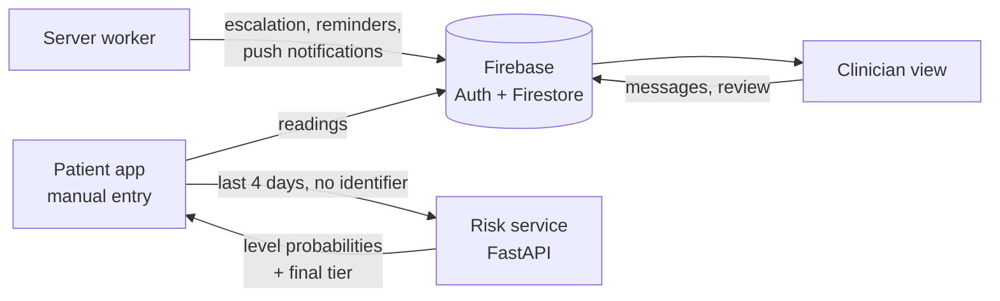

# TeleMonitor — telemonitoring for hypertension and diabetes

TeleMonitor is a telemonitoring system for patients living with **hypertension and/or type 2 diabetes** in Cameroon. Patients record their blood pressure, pulse and blood glucose in a mobile app. A guideline-based rule and a machine-learning model turn the recent readings into a risk level (green, yellow, red), and the patient's clinician follows them from the same app.

The project is the subject of a Master's thesis in Data Science and Artificial Intelligence at the **National Advanced School of Engineering of Douala (ENSPD), University of Douala**:

> *Design of a Telemonitoring System for Patients with Chronic Diseases (Hypertension, Diabetes) Using Consultation Data, Home Measurements and Possibly Mobile Sensors*
> Nsame Ayuni Rodrick — supervised by Dr. Malong and Dr. Noulapeu

The project is a work in progress: this page describes it as it stands and will be updated as the work advances.

## What is in this repository

| Folder | Content |
|---|---|
| [`telemonitor/`](telemonitor/) | The application (Flutter): patient and clinician views, Firebase back end |
| [`telemonitor-research/`](telemonitor-research/) | The research code (Python): labelling rule, data quality, features, benchmark of risk models, local risk service and server worker |
| [`memoire/`](memoire/) | The thesis (LaTeX): parts `00_front` to `07_appendices` in `parts/`, data-driven figures in `figures/`, bibliography, compiled PDF |
| [`infra/windows/`](infra/windows/) | PowerShell scripts that launch the long benchmark runs on Windows |

## How the system works



- **Guideline rule first.** Each reading is graded on four levels (stable, moderate, high, critical) from sourced thresholds: ESH 2023 grades for blood pressure, NEWS2 red scores for low pressure and pulse, IHSG/ADA/CMS for glucose. The rule runs on the phone, offline.
- **Model on top.** When the risk service is reachable, the model selected by the benchmark estimates the probability of each level at the next reading. The model may raise the tier set by the rule, never lower it.
- **Home triage.** A yellow reading first asks the patient for a short verification profile (repeated measurements); red readings and profiles off target reach the clinician first, yellow ones are queued behind them.
- **Clinician in the loop.** The app never advises on medication. The clinician reviews the queue and decides.

## Research method in brief

- **Data.** Models are trained and compared on the public **eICU Collaborative Research Database** (US intensive-care stays, harmonised to two readings a day) and validated externally on **inpatient charts from a public hospital in Douala** (32 patients, 366 readings). Outpatient consultation records from the same hospital describe the fragmentation of follow-up.
- **Task.** Forecast the risk level of the next reading from a past window, so that the label is never computed from the model's own inputs.
- **Models compared.** Proportional-odds logistic regression, random forest, CatBoost, value forecasts, GRU-D and masked LSTM, against the guideline rule applied to the last reading (persistence).
- **Evaluation.** Nested cross-validation (outer folds by hospital, inner folds by patient), proper scoring rules (ranked probability score, Brier score), calibration and net benefit, reported according to TRIPOD+AI.

Every number of the methodology is produced by a script in [`telemonitor-research/scripts/`](telemonitor-research/scripts/); protocols are declared in [`telemonitor-research/configs/`](telemonitor-research/configs/) before any run.

## Getting started

### Research code and tests (Python ≥ 3.10)

```powershell
cd telemonitor-research
python -m venv .venv
.venv\Scripts\activate
pip install -e .[test,bench,serve]
python -m pytest
```

The guide [`BENCHMARKS.md`](telemonitor-research/BENCHMARKS.md) lists every script in the order of the methodology, the data each one needs and how long it runs.

### Risk service (local)

```powershell
cd telemonitor-research
$env:TELEMONITOR_ARTIFACTS = "artifacts"
$env:TELEMONITOR_CORS = "http://localhost:5000"     # only needed for the web version of the app
uvicorn telemonitor.serve.app:app --app-dir src --host 127.0.0.1 --port 8000
```

Interactive documentation: <http://127.0.0.1:8000/docs>. Without exported model artifacts the service applies the guideline rule only.

### Application (Flutter)

```powershell
cd telemonitor
flutter pub get
flutter run -d chrome --web-port 5000 --dart-define=RISK_API_URL=http://localhost:8000
```

On an Android emulator, use `--dart-define=RISK_API_URL=http://10.0.2.2:8000` instead. Without `RISK_API_URL` the app runs with the guideline rule only.

### Server worker (escalation, reminders, notifications)

Requires a Firebase service-account key in `telemonitor-research/secrets/service-account.json` (excluded from git, never share it). See section 7 of [`BENCHMARKS.md`](telemonitor-research/BENCHMARKS.md).

### Thesis

```powershell
cd memoire
python ../telemonitor-research/scripts/14_thesis_data_figures.py   # once per machine: data behind the figures
python parts/build.py
pdflatex memoire_restructure.tex; biber memoire_restructure; pdflatex memoire_restructure.tex; pdflatex memoire_restructure.tex
```

The thesis follows the structure required by the school (unnumbered Introduction and Conclusion, four chapters, at most 90 pages); [`memoire/RESTRUCTURE_90.md`](memoire/RESTRUCTURE_90.md) gives the plan and its status. The results tables are written by `scripts/13_results_tables.py` from completed benchmark runs only.

## Status

| Built | Specified, not built yet |
|---|---|
| Patient app: manual entry, history, trends, risk card, messaging, health assistant, nearby-care search | Bluetooth acquisition from validated devices |
| Clinician view of assigned patients; review queue (red before yellow) with verdict and action capture | Clinical pilot analysing the captured verdicts |
| Offline guideline rule on the phone | Sensor prototype (ESP32) and MQTT transport |
| Local risk service sharing the research code | Online hosting of the risk service |
| Server worker with push notifications | SMS fallback |
| Research pipeline; data description and sample size (Douala, eICU demo) | Benchmark on the full eICU database (credentialed access) |
| Thesis (70 pages): introduction, review, framework, methodology, data results, system verification | Benchmark results (runs in progress), abstract, acknowledgments |

## Data

- **eICU demo 2.0.1** is open access on [PhysioNet](https://physionet.org/content/eicu-crd-demo/2.0.1/); download it into `telemonitor-research/data/external/` as described in `BENCHMARKS.md`. The full database requires PhysioNet credentialing and a data use agreement.
- **Douala data** are confidential patient records, used for research only with the agreement of the partner hospital. They must not be redistributed.

## Key documents

| Document | Content |
|---|---|
| [`telemonitor-research/RESEARCH_PLAN.md`](telemonitor-research/RESEARCH_PLAN.md) | Step-by-step plan, standing decisions and the register of incoherences found and fixed |
| [`telemonitor-research/BENCHMARKS.md`](telemonitor-research/BENCHMARKS.md) | How to rerun every analysis |
| [`memoire/memoire_restructure.pdf`](memoire/memoire_restructure.pdf) | Current version of the thesis (draft; benchmark results to come) |
| [`memoire/RESTRUCTURE_90.md`](memoire/RESTRUCTURE_90.md) | Plan of the thesis, page budget and what remains to write |

## Author

**Nsame Ayuni Rodrick** — M2 Data Science and Artificial Intelligence, ENSPD, University of Douala.

No license has been chosen yet: all rights are reserved until one is added.
