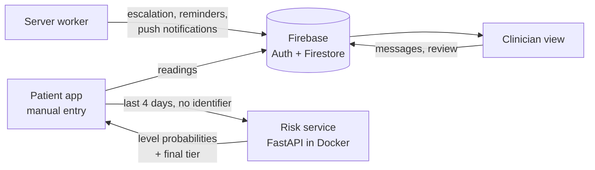

# Design of a Telemonitoring System for Patients with Chronic Diseases (Hypertension, Diabetes) Using Consultation Data, Home Measurements and Possibly Mobile Sensors

Master's thesis in Data Science and Artificial Intelligence, **National Higher Polytechnic School of Douala (NHPSD), University of Douala**, academic year 2025–2026.
**Nsame Ayuni Rodrick** — supervised by Dr. Malong Yannick and Dr. Noulapeu Ngaffo Armielle.

**TeleMonitor** is the system designed in this thesis, for patients living with **hypertension and/or type 2 diabetes** in Cameroon. It has two parts:

- a **mobile app** (Flutter), where patients record their blood pressure, pulse and blood glucose, and where their clinician follows them;
- a **risk service** that holds the models selected by the benchmark (CatBoost for blood pressure, GRU-D for glucose). It runs in a **Docker container**; the app sends it the recent readings and receives a risk level (green, yellow, red). When the service cannot be reached, the app falls back on a guideline-based rule that runs on the phone.

The project is a work in progress: this page describes it as it stands and will be updated as the work advances.

## What is in this repository

| Folder or file | Content |
|---|---|
| [`telemonitor/`](telemonitor/) | The application (Flutter): patient and clinician views, Firebase back end |
| [`telemonitor-research/`](telemonitor-research/) | The research code (Python): labelling rule, data quality, features, benchmark of risk models, risk service and server worker |
| [`docker-compose.yml`](docker-compose.yml) | Runs the risk service (the models used by the app), the server worker and the tests in Docker |
| [`memoire/`](memoire/) | The thesis (LaTeX): parts `00_front` to `07_appendices` in `parts/`, data-driven figures in `figures/`, bibliography, compiled PDF |
| [`infra/windows/`](infra/windows/) | PowerShell scripts that launch the long benchmark runs on Windows |

## How the system works



- **Guideline rule first.** Each reading is graded on four levels (stable, moderate, high, critical) from sourced thresholds: ESH 2023 grades for blood pressure, NEWS2 red scores for low pressure and pulse, IHSG/ADA/CMS for glucose. The rule runs on the phone, offline.
- **Model on top.** When the risk service is reachable, the model selected by the benchmark estimates the probability of each level at the next reading. The model may raise the tier set by the rule, never lower it.
- **Home triage.** A yellow reading first asks the patient for a short verification profile (repeated measurements); red readings and profiles off target reach the clinician first, yellow ones are queued behind them.
- **Clinician in the loop.** The app never advises on medication. The clinician reviews the queue and decides.

## Research method in brief

- **Data.** Models are trained and compared on the public **eICU Collaborative Research Database** (US intensive-care stays, harmonised to two readings a day) and validated externally on **inpatient charts from a public hospital in Douala** (32 patients, 366 readings). Outpatient consultation records from the same hospital describe the fragmentation of follow-up.
- **Task.** Forecast the risk level of the next reading from a past window, so that the label is never computed from the model's own inputs.
- **Models compared.** Proportional-odds logistic regression, random forest, CatBoost, value forecasts, GRU-D and masked LSTM, against the guideline rule applied to the last reading (persistence).
- **Evaluation.** Nested cross-validation (outer folds by hospital, inner folds by patient), proper scoring rules (ranked probability score, Brier score), calibration and net benefit, reported according to TRIPOD+AI.

Every number of the methodology is produced by a script in [`telemonitor-research/scripts/`](telemonitor-research/scripts/); protocols are declared in [`telemonitor-research/configs/`](telemonitor-research/configs/) before any run.

## Getting started

### Research code and tests (Python ≥ 3.10)

```powershell
cd telemonitor-research
python -m venv .venv
.venv\Scripts\activate
pip install -e .[test,bench,serve]
python -m pytest
```

The guide [`BENCHMARKS.md`](telemonitor-research/BENCHMARKS.md) lists every script in the order of the methodology, the data each one needs and how long it runs.

### Risk service with Docker (the models the app uses)

Docker Desktop runs the risk service, the server worker and the tests in a container that holds the exact library versions of the thesis (`requirements-lock.txt`), without a local Python environment. From `C:\Projects`:

```powershell
docker compose build                 # once, and when requirements-lock.txt changes
docker compose up -d api             # risk service on http://localhost:8000, restarted with Docker Desktop
docker compose run --rm tests        # research test suite
```

The service answers on <http://localhost:8000/health> (status and loaded models) and documents itself on <http://localhost:8000/docs>. After a change of code, configs or exported model, `docker compose restart api` is enough. The service container reads code, configs and models only, read-only: patient data, outputs and keys never enter the image. All commands, including the worker, are listed at the top of [`docker-compose.yml`](docker-compose.yml).

### Risk service without Docker

```powershell
cd telemonitor-research
$env:TELEMONITOR_ARTIFACTS = "artifacts"
$env:TELEMONITOR_CORS = "http://localhost:5000"     # only needed for the web version of the app
uvicorn telemonitor.serve.app:app --app-dir src --host 127.0.0.1 --port 8000
```

Without exported model artifacts the service applies the guideline rule only.

### Application (Flutter)

```powershell
cd telemonitor
flutter pub get
flutter run -d chrome --web-port 5000 --dart-define=RISK_API_URL=http://localhost:8000
```

On an Android emulator, use `--dart-define=RISK_API_URL=http://10.0.2.2:8000` instead. Without `RISK_API_URL` the app runs with the guideline rule only.

A physical Android phone connected by USB reaches the service through `adb`, with no network or firewall involved:

```powershell
adb reverse tcp:8000 tcp:8000        # again after each reconnection of the phone
flutter run --dart-define=RISK_API_URL=http://localhost:8000
```

Over Wi-Fi instead, publish the service on the network (`$env:RISK_API_BIND = "0.0.0.0"; docker compose up -d api`) and use `http://<computer IP>:8000` (`ipconfig`). On a network set to Public, Windows Firewall blocks Docker's incoming connections: the phone gets through only on a trusted network set to Private, with Docker Desktop allowed when Windows asks.

**English and French.** The app is in English or French: the phone's language at first, then the user's choice (EN | FR on the login screen and the clinician's bar, Language in the patient's profile), kept on the phone and on the account (`users/{uid}.language`), so the worker's notifications and emails come in it too. The texts are in `telemonitor/lib/l10n/app_en.arb` and `app_fr.arb` (the Dart code is generated from them by `flutter gen-l10n`, also run by `flutter pub get`); a new text goes in both, which `test/l10n_test.dart` checks. Values stored in Firestore (reading context, sex, levels) stay in English and are only shown translated. `flutter test test_screens --update-goldens` also captures the screens in French, and fails on any overflow.

### Server worker (escalation, reminders, notifications)

The phones receive alerts, reminders, review notices and new-message notices only while the worker runs; it also sends the email confirming a new patient's address (below). A message still unread 20 seconds after it was sent is notified to the other side (the patient, or the assigned clinician), naming who wrote but never the text, since the notification shows on a locked screen; a tap opens the conversation. The worker listens to new messages, so this costs one Firestore read per message; the listener needs the index in `telemonitor/firestore.indexes.json` (`firebase deploy --only firestore`). Its minute cycle reads users, readings and events from memory, kept up to date by listeners in the same way (one read per new or changed document): polling cost several reads per patient a minute, and the free plan allows 50,000 reads a day. Until a listener runs (the readings one needs its index too), the cycle reads Firestore directly and says so in the log. The worker needs a Firebase service-account key: Firebase console, Project settings, Service accounts, *Generate new private key*, saved as `telemonitor-research/secrets/service-account.json` (excluded from git, never share it). Then, from `C:\Projects`:

```powershell
docker compose --profile worker up -d worker                     # runs until stopped
docker compose run --rm worker python -m telemonitor.serve.worker --credentials /work/secrets/service-account.json --test-push <account email>
```

The second command sends a test notification to the phones signed in to that account and says why nothing was sent when no phone is registered (in the app: Profile, Account, Notifications). See also section 7 of [`BENCHMARKS.md`](telemonitor-research/BENCHMARKS.md).

**Confirmation and password-reset emails.** The links that confirm a new patient's address and choose a new password are Firebase's, but the emails carrying them can be TeleMonitor's own: logo, greeting by name, a button (`telemonitor-research/src/telemonitor/serve/mail.py`). Firebase does not let this project change its own templates, hence emails sent by the worker. The worker sends them through an email account described in `telemonitor-research/secrets/smtp.json`; the format is at the top of `mail.py`. For a Gmail account, use an app password (Google account, Security, 2-Step Verification, App passwords), not the account's password. The app asks the worker only while it runs, and otherwise sends Firebase's standard email, so a link never depends on the worker. "Forgot password?" is used signed out, so anyone may ask for any address: the worker answers only for an existing account, to that account's own address, at most five times a day (`password_resets_per_day` in `configs/worker.yaml`; the rules allow one request a minute per address). A brand-new sending account lands in the spam folder at first; each "Not spam" teaches the mailbox. Notifications and emails are in the language each user chose in the app (`notify` and `notify_fr` in `configs/worker.yaml`, `WORDS` in `mail.py`). To check the account, after `docker compose --profile worker restart worker`:

```powershell
docker compose run --rm worker python -m telemonitor.serve.worker --credentials /work/secrets/service-account.json --test-mail <account email>
```

### Research extract (consenting patients only)

Patients accept the terms of use at sign-up and choose, separately, whether their data may be used for research; they can change that choice in their profile. With the same key as the worker:

```powershell
docker compose run --rm research python -m telemonitor.serve.research_export --credentials secrets/service-account.json
```

This writes `telemonitor-research/out/research_export/<date>/` (git-ignored): patients, readings and alerts of the consenting patients only, without names, contact details, photos, messages or notes. Patients and readings are codes made with a key kept in `secrets/research_export.key`, so successive extracts can be joined. Readings that carry both the monitor's pulse (`hr`) and the pulse measured with the phone camera (`hrCamera`, with its signal quality) are the pairs of a Bland–Altman comparison of the camera with the monitor.

### Thesis

```powershell
cd memoire
python ../telemonitor-research/scripts/14_thesis_data_figures.py   # once per machine: data behind the figures
python parts/build.py
pdflatex memoire_restructure.tex; biber memoire_restructure; pdflatex memoire_restructure.tex; pdflatex memoire_restructure.tex
```

The thesis follows the structure required by the school (unnumbered Introduction and Conclusion, four chapters, appendices) in a standard LaTeX layout; [`memoire/RESTRUCTURE_90.md`](memoire/RESTRUCTURE_90.md) gives the plan and its status. The results tables are written by `scripts/13_results_tables.py` and `scripts/15_results_details.py` from completed benchmark runs only. The figures that read the Douala data need the confidential files described under [Data](#data).

## Status

| Built | Specified, not built yet |
|---|---|
| Patient app, in English or French: manual entry, history, trends, risk card, messaging, health assistant, nearby-care search, optional profile photo; email confirmation, terms of use and separate research consent; pulse with the phone camera (shown for information beside the monitor's pulse, not used by the alerts) | Bluetooth acquisition from validated devices |
| Clinician view of assigned patients; review queue (red before yellow) with verdict and action capture | Clinical pilot analysing the captured verdicts |
| Offline guideline rule on the phone | Sensor prototype (ESP32) and MQTT transport |
| Risk service holding the deployed models, run in Docker on the computer and reached by the app | Online hosting of the risk service |
| Server worker with push notifications; pseudonymised research extract of consenting patients | SMS fallback |
| Research pipeline; benchmark on the eICU demo, external validation in Douala; deployed models exported (CatBoost for blood pressure, GRU-D for glucose) | Benchmark on the full eICU database (credentialed access) |
| Thesis (115 pages): all chapters, benchmark and external validation results, abstract and résumé | Acknowledgments; lead times of 24 and 48 h (H2: runs at 12 and 36 h to make, the table is ready) |

## Data

- **eICU demo 2.0.1** is open access on [PhysioNet](https://physionet.org/content/eicu-crd-demo/2.0.1/); download it into `telemonitor-research/data/external/` as described in `BENCHMARKS.md`. The full database requires PhysioNet credentialing and a data use agreement.
- **Douala data** are confidential patient records, used for this research only, under the written research authorisation of the partner hospital (25 September 2026). They are **not in this repository** and must not be redistributed; without them, the tests that need them are skipped.
- The old pipeline written before the `telemonitor` package, whose notes report results on synthetic data, and the earlier versions of the thesis are no longer in the repository.

## Key documents

| Document | Content |
|---|---|
| [`telemonitor-research/RESEARCH_PLAN.md`](telemonitor-research/RESEARCH_PLAN.md) | Step-by-step plan, standing decisions and the register of incoherences found and fixed |
| [`telemonitor-research/BENCHMARKS.md`](telemonitor-research/BENCHMARKS.md) | How to rerun every analysis |
| [`memoire/memoire_restructure.pdf`](memoire/memoire_restructure.pdf) | Current version of the thesis (draft under review) |
| [`memoire/RESTRUCTURE_90.md`](memoire/RESTRUCTURE_90.md) | Plan of the thesis, page budget and what remains to write |

## Author

**Nsame Ayuni Rodrick** — M2 Data Science and Artificial Intelligence, NHPSD, University of Douala.

No license has been chosen yet: all rights are reserved until one is added.
